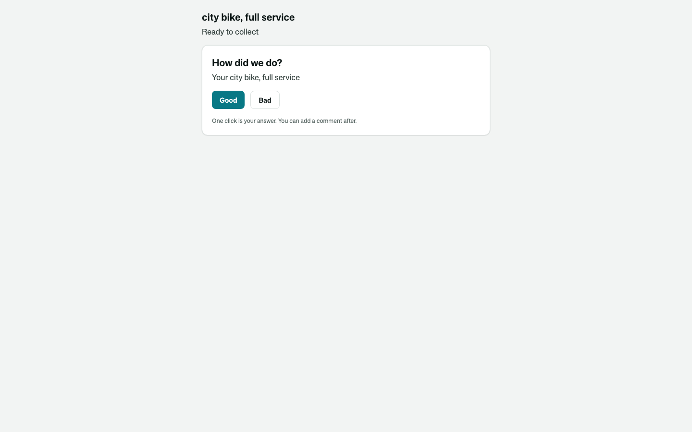
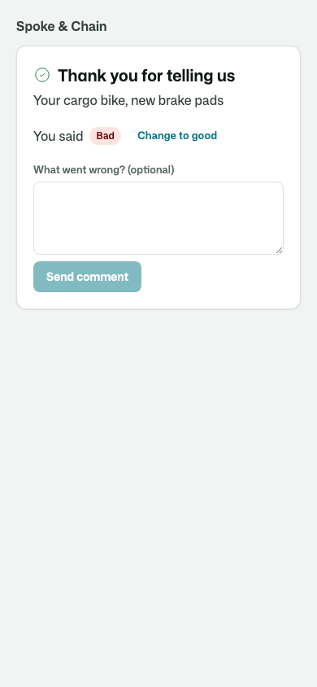
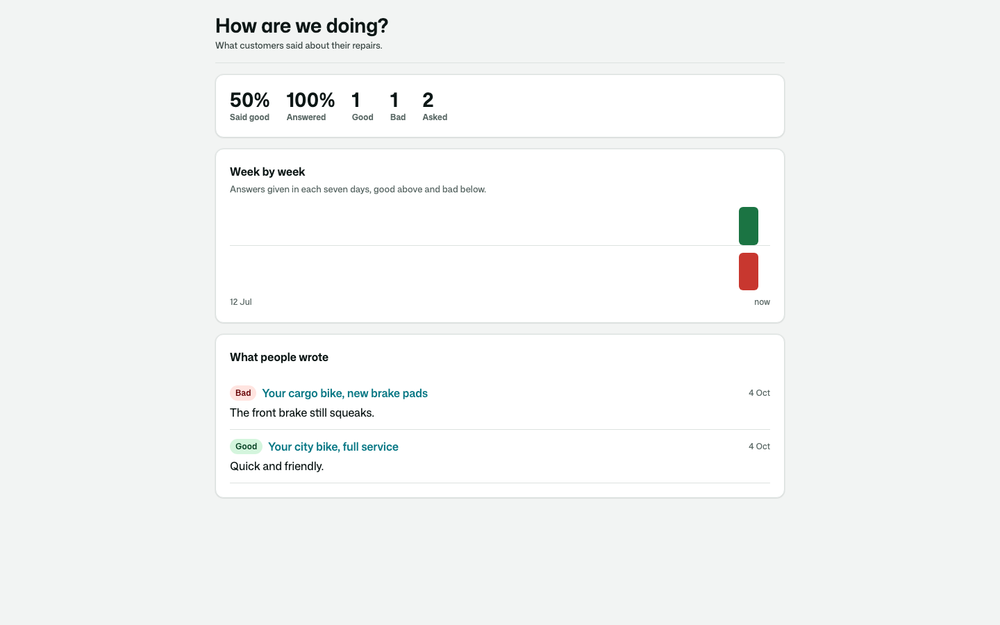
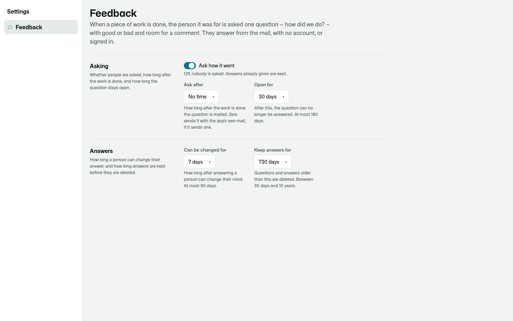

# Osysharp.SatisfactionSurveys

Ask the person a piece of work was for how it went. One question, good or bad, with room for a comment. They answer
from the mail with one click and no account, or signed in on the work's own page. Each person has one answer per piece
of work, held by the database, and can change their mind for a while after. Your team reads how it is going week by
week, with what people wrote.

**Use case.** A cycle workshop finishes a repair. The customer who booked online sees "How did we do?" on their
repair's page; the one who rang the shop gets it by mail. A bad answer lands on the repair's record and tells the
mechanic. The same kit asks a shop's customer about their delivery, or a support desk's customer about a solved
request: it never knows what the work was.

```osy
use Osysharp.SatisfactionSurveys@0;

policy ReadsFeedback => IsMechanic;        // who reads answers and results
policy ManagesFeedback => IsOwner;         // who decides whether and when to ask

[On] void RepairAnswered(FeedbackAnswered e) {      // after the commit, as the app
  if (e.Ask.About is Repair r) { … }
}
app.Feedback = new FeedbackSetup { AppName = "Spoke & Chain" };

[Route("/repairs/{id}")] [Opens(Repair)] component RepairPage(Guid id) { … }   // where the team opens it

// when the work is done — about the repair itself, any record the app keeps
AskForFeedback(repair, "Your city bike, full service", person: repair.Customer, address: repair.Email);

FeedbackPrompt(repair.Id);     // on the repair's page, for its signed-in customer
FeedbackResults();             // on a page of your own, for the team
```

## What it does

| | |
|---|---|
| **One click is an answer** | the mail carries Good and Bad as links; following one records it and opens a page that thanks them and takes a comment |
| **No account needed** | the mail's link answers that one question and reads nothing else in the app; signed in, the question is on the work's own page |
| **One answer per person and piece of work** | asking twice never makes a second question; answering again changes the answer, until its window closes |
| **Only its person answers** | the account it was asked of, or whoever holds its link. Answers are applied after the commit and checked again, then the kit raises `FeedbackAnswered`, which your `[On]` handler hears — and which says itself in a bell or on a timeline ("Kim Lund said it did not go well.") |
| **Five states, all designed** | open, answered (with a comment box and "change to bad"), settled, closed, and no longer asked when the work is opened again |
| **Your own mail can carry it** | a mail you send anyway ("your repair is ready") puts the question in with `TakeFeedbackMail` and `FeedbackMailQuestion` |
| **Settings staff own** | whether to ask, how long after the work, how long the question stays open, how long an answer can change, how long answers are kept |
| **Results** | asked, answered, the share that said good, good and bad week by week, and the latest comments, each only for whoever may read the work — the work's own security, read as the reader — linked to where it opens |
| **Personal data** | the address and what people wrote are classified; with `Osysharp.Privacy`, `Osysharp.Privacy.SatisfactionSurveys` counts, copies, restricts and erases a person's answers |

One question, good or bad, by design. A 0–10 score or a survey of several questions is a different question.

## Screens

| | |
|---|---|
| The question on the work's page |  |
| Answered from the mail, on a phone |  |
| How it is going |  |
| When and whether to ask |  |

## Its tests

Every behaviour above is proven against a small workshop app, its screens photographed with `osy test --pixels`.

## Examples

Taken from this package's own tests, which compile and run on every release.

```osy
using Osysharp.Identity;
using Osysharp.SatisfactionSurveys;
using Osysharp.Mail;
using FeedbackKitTests;

[Test(Workshop)]
void a_finished_repair_asks_its_customer_and_one_click_answers() {
  Finish("city bike");
  var view = KimsQuestion("city bike")!;
  Assert.Equal(FeedbackStage.Open, view.Stage);
  Assert.Equal("Your city bike, full service", view.Title);
  runas (Kim) { AnswerMyFeedback(view.Ask, FeedbackRating.Good); }
  // Said at once, applied after the commit.
  Assert.Equal(FeedbackStage.Answered, KimsQuestion("city bike")!.Stage);
  Background.Settle();
  Assert.Equal(FeedbackRating.Good, AskedAbout("city bike").Rating);
  Assert.Equal(["answered good"], NotesOn("city bike"));
  runas (Mia) {
    var r = Repair.Single(x => x.Bike.StartsWith("city bike"));
    Assert.Equal(FeedbackRating.Good, FeedbackRatingOf(r));
    Assert.Equal(1, FeedbackAnswersAbout(r).Count);
  }
}
```

From [`tests/answers.test.osy`](tests/answers.test.osy).

```osy
using Osysharp.Identity;
using Osysharp.SatisfactionSurveys;
using Osysharp.Mail;
using FeedbackKitTests;

[Test(Workshop)]
void asking_switched_off_asks_nobody() {
  Settings(false, TimeSpan.Zero, TimeSpan.FromDays(730));
  Finish("cargo bike");
  Assert.Empty(MailTo("lena@riders.test"));
  var r = RepairOf("cargo bike");
  runas (Olle) { Assert.Equal(0, FeedbackAsk.Count(a => a.About == r)); }
}
```

From [`tests/asking.test.osy`](tests/asking.test.osy).

```osy
using Osysharp.Identity;
using Osysharp.SatisfactionSurveys;
using Osysharp.Mail;
using FeedbackKitTests;

[Test(Workshop)]
void a_repair_nobody_was_asked_about_shows_no_question() {
  Assert.Null(KimsQuestion("city bike"));
}
```

From [`tests/answers.test.osy`](tests/answers.test.osy).

## Learn more

- [The Osysharp.SatisfactionSurveys reference](https://osysharp.com/reference/ui/feedback-kit/)
- [Osysharp.SatisfactionSurveys in the package catalogue](https://osysharp.com/packages/#osysharp-satisfactionsurveys)
- [The Osy# reference](https://osysharp.com/reference/) — the language, the runtime and every kit
- [`llms-full.txt`](https://osysharp.com/llms-full.txt) — the whole reference and specification as one Markdown file, for a coding agent

## Licence

MIT — see [`LICENSE`](LICENSE).
